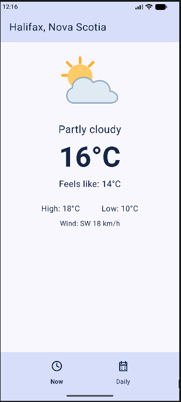
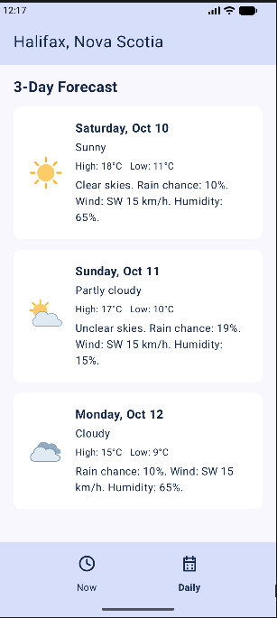

# WeatherApp

A simple Android weather app built with Kotlin and Jetpack Compose for **MOBI3002/2925 — Mobile Application Development, Assignment 1: Weather App — Phase 1** at NSCC.

This phase focuses on user interface design and navigation. All weather information is **placeholder data**, rather than live weather readings.

## Features

- **Now screen:** Displays Halifax’s sample weather condition, temperature, feels-like temperature, high, low, and wind.
- **Daily screen:** Displays a three-day forecast with dates, weather icons, temperatures, and short weather summaries.
- **Bottom navigation:** Clock and calendar icons switch between Now and Daily.
- **Scrollable screens:** Allow weather details to remain accessible when screen space is limited.
- **Saved screen selection:** Preserves the selected screen during device rotation.
- **Added Celsius/Fahrenheit switching on both screens to the features.

## Screenshots

### Current Weather

### Three-Day Forecast

## Design

The interface uses a light background, navy text, and contrasting header and navigation bars. A large temperature highlights the current weather, while forecast cards group each day’s details.

Weather and navigation icons are vector XML resources stored in `app/src/main/res/drawable`.

## Technologies

- Kotlin
- Jetpack Compose
- Android Studio
- Git and GitHub

## Code Structure

- `MainActivity`: Starts the app and applies its theme.
- `WeatherApp`: Displays the header, selected screen, and bottom navigation.
- `CurrentWeatherScreen`: Displays current placeholder weather.
- `ForecastDay`: Stores the information for one forecast day.
- `ForecastScreen`: Creates a card for each day in the forecast list.

## Running the App

1. Clone or download this repository.
2. Open the project in Android Studio.
3. Allow Gradle to sync.
4. Select an Android emulator or connected Android device.
5. Click **Run**.

## Current Scope

Temperatures, conditions, forecast dates, and summaries are fixed sample values. The app does not currently retrieve live weather or detect the device’s location. API integration is planned for Phase 2.

## Acknowledgements

ChatGPT assisted with Kotlin/Compose code, vector drawable XML, layout suggestions, and explanations during development.

Android documentation:
- [Jetpack Compose resources](https://developer.android.com/develop/ui/compose/resources)
- [VectorDrawable](https://developer.android.com/reference/android/graphics/drawable/VectorDrawable)

## Author

**John Nwosu**  
IT Programming student, NSCC
